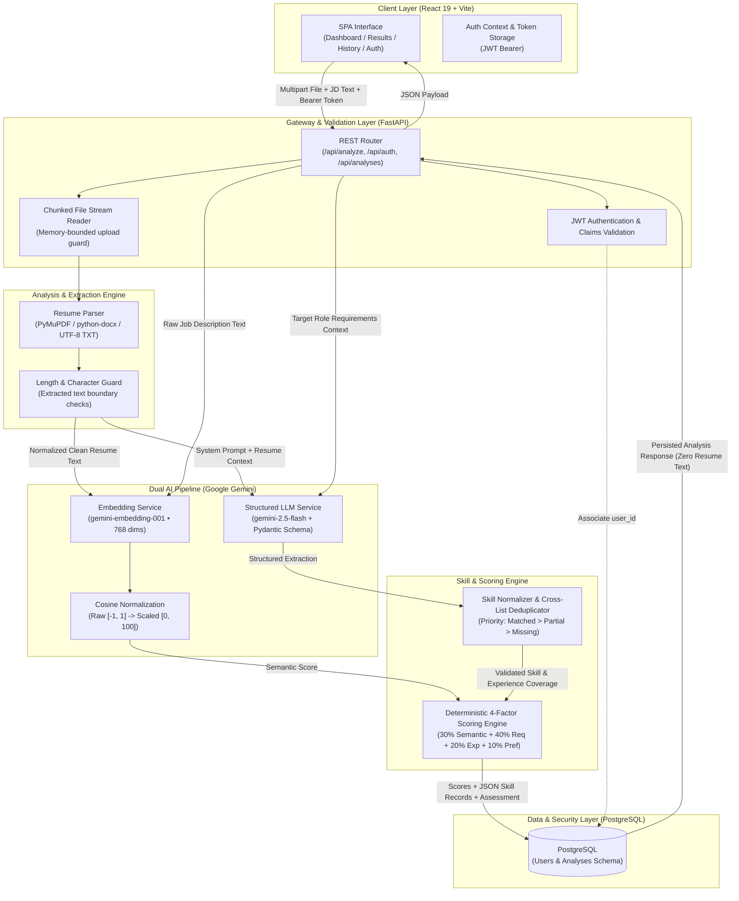

# ResumeMatch — AI-Powered Resume-Job Description Alignment Platform

> A production-grade, full-stack AI evaluation engine that parses candidate resumes across multiple formats, models semantic and contextual requirement fit using Google Gemini LLMs and high-dimensional embeddings, and computes explainable compatibility metrics via a deterministic multi-factor scoring formula.

---

## Complete System Flow & Architecture



---

## 1. WHAT: System Overview & Capabilities

ResumeMatch automates the tedious, error-prone process of cross-referencing candidate credentials against role requirements. Rather than performing simple keyword matching or relying on opaque AI scores, the platform executes a comprehensive, multi-layered candidate evaluation.

### Core Capabilities
* **Multi-Format Document Parsing:** Ingests PDF, DOCX, and raw text files through in-memory byte streaming without writing raw files to disk.
* **Semantic Vector Alignment:** Embeds resume and job requirements into 768-dimensional vector spaces to capture semantic intent, domain terminology, and implicit conceptual overlap.
* **Structured Skill Classification:** Categorizes technical and functional requirements into three distinct buckets with contextual reasoning:
  * **Matched Skills:** Explicitly demonstrated skills aligned with job requirements.
  * **Missing Skills:** Crucial job expectations absent from the candidate's documentation.
  * **Partial Matches:** Adjacent tools, frameworks, or responsibilities requiring stronger demonstration.
* **Candidate Diagnostics:** Synthesizes bulleted core strengths, critical gaps, and strictly grounded resume improvement suggestions.
* **Isolated Multi-User Workspaces:** Encapsulates personal submissions, private dashboard history, and lifecycle management behind JWT authentication and PostgreSQL relational foreign keys.

---

## 2. HOW: Technical Architecture & Execution

The system is constructed as a high-performance modular monolith that balances synchronous AI execution with strict resource boundaries.

### A. Memory-Bounded Stream Ingestion
- Uploads are processed via a chunked reader (`64 KB` buffer size) that enforces hard file-size constraints (`5 MB` ceiling) *during transfer*, preventing buffer-overflow vectors and unbounded memory spikes.
- Extraction routes dynamically between **PyMuPDF** (`fitz`) for PDF stream deserialization, **python-docx** for XML package parsing, and a fallback decoder (UTF-8 with Latin-1 recovery) for raw text.
- Extracted text undergoes whitespace normalization and character count validation (`15,000` character cap) prior to external API dispatch.

### B. Dual-Track AI Pipeline
1. **Geometric Semantic Similarity:**
   - Both resume and job description texts are vector-embedded using `gemini-embedding-001` configured to `768` dimensions.
   - Computes cosine similarity between directional vectors:
     $$\text{raw} = \frac{\mathbf{u} \cdot \mathbf{v}}{\|\mathbf{u}\|_2 \|\mathbf{v}\|_2}$$
   - Maps the theoretical range $[-1.0, 1.0]$ into a scaled score $[0, 100]$ using a linear heuristic transformation:
     $$\text{Score}_{\text{semantic}} = \max\left(0, \min\left(100, \frac{\text{raw} + 1.0}{2.0} \times 100\right)\right)$$
2. **Schema-Constrained LLM Reasoning:**
   - Dispatches extraction tasks to `gemini-2.5-flash` bound to a native Pydantic output schema (`GeminiAnalysis`).
   - Guarantees strongly-typed JSON outputs covering required skill coverage, preferred coverage, experience relevance, skill arrays, strengths, weaknesses, and overall assessments without downstream markdown parsing failures.

### C. Cross-List Priority Deduplication
To eliminate conflicting skill classifications (e.g., an LLM flagging a skill as both matched and missing), the `skill_matcher` module normalizes keys (case folding, punctuation removal, whitespace collapsing) and enforces strict priority inheritance:
$$\text{Matched} \succ \text{Partial} \succ \text{Missing}$$
A skill present in a higher-priority bucket is automatically purged from all lower-priority collections, preserving the highest-confidence explanation.

### D. Deterministic 4-Factor Scoring Formulation
To ensure mathematical reproducibility, the final compatibility score is calculated programmatically by the backend—never by the LLM:

$$\text{Final Score} = (\text{Semantic} \times 0.30) + (\text{Required Skills} \times 0.40) + (\text{Experience Relevance} \times 0.20) + (\text{Preferred Skills} \times 0.10)$$

| Dimension | Weight | Target Metric |
|---|---:|---|
| **Required Skills Match** | **40%** | Explicit coverage of mission-critical job competencies |
| **Semantic Similarity** | **30%** | Latent semantic and contextual alignment in vector space |
| **Experience Relevance** | **20%** | Seniority, project scope, and functional responsibility alignment |
| **Preferred Skills Match** | **10%** | Coverage of secondary/bonus qualifications |

---

## 3. WHY: Engineering Trade-offs & Decisions

| Architectural Decision | Chosen Approach | Alternative Considered | Technical Rationale |
|---|---|---|---|
| **Scoring Engine** | Deterministic Weighted Python Function | Pure LLM-generated score | LLMs are inherently non-deterministic and suffer from calibration drift. By decoupling requirement evaluation (LLM) from score calculation (Python formula), every score is transparent, explainable, and audit-friendly. |
| **Structured Output** | Native Pydantic `response_schema` | Regex & JSON prompt parsing | Prompting an LLM to "return raw JSON" frequently fails under edge cases due to markdown fences and escaped characters. Native SDK schema enforcement yields runtime type safety and zero deserialization failures. |
| **Data Privacy Policy** | Zero raw resume storage (ephemeral lifecycle) | Storing original PDF binaries or full text in PostgreSQL / S3 | Resumes contain highly sensitive PII (contact details, addresses, employment records). By persisting only extracted skill tokens and quantitative metrics, data exposure risks are structurally eliminated. |
| **Skill Conflict Handling** | Set-based Priority Deduplication | Accepting raw model output | LLM extractions occasionally assign different facets of the same technology to multiple categories. Priority deduplication ensures mathematical consistency across visual indicators. |
| **Deployment Packaging** | Multi-Stage Docker Container | Separate services for Frontend and Backend | Building the React 19 bundle in Node 22-Alpine and copying static assets into a slim Python 3.11 runtime creates a single deployable artifact that serves both API endpoints and client SPA without CORS complexity or multiple cloud billing tiers. |
| **Password Security** | Blowfish Adaptive Hashing (`bcrypt`) | Plain SHA-256 / MD5 hashing | SHA-256 is susceptible to GPU-accelerated rainbow table attacks. Bcrypt introduces computational work factors and unique salts per credential to ensure enterprise-grade access security. |

---

## Technology Stack

```
Frontend:     React 19 • Vite • Lucide Icons • CSS3 Grid & Tokens
Backend:      Python 3.11 • FastAPI • Uvicorn • Pydantic v2
Database:     PostgreSQL • SQLAlchemy 2.x • Alembic Migrations
AI & ML:      Google Gemini 2.5 Flash • Gemini Embedding 001 • NumPy
Parsing:      PyMuPDF (fitz) • python-docx • python-multipart
Security:     Bcrypt • PyJWT (HS256) • CORS Policy
Container:    Docker (Multi-Stage Node/Python build)
```
